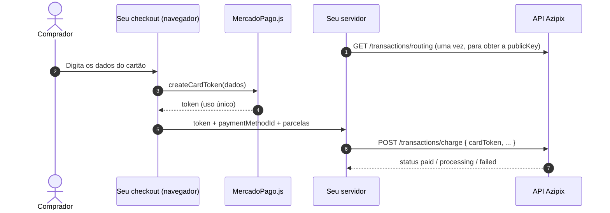

<Warning>
  **A API não aceita número de cartão nem CVV.** Os dados do cartão vão direto do navegador do comprador para o processador, que devolve um **token**. Seu servidor envia só esse token para a Azipix. Assim, nem você nem a Azipix armazenam ou trafegam dados de cartão (exigência PCI-DSS).
</Warning>

## Como funciona



## 1. Obtenha a Public Key

A Public Key identifica a conta que processa os seus cartões. Ela é **pública** (pode ir para o navegador) e muda só se a Azipix trocar a conta. Busque-a uma vez e guarde em cache:

```bash
curl https://api.azipix.com/api/transactions/routing \
  --header 'x-api-key: ak_live_SUA_CHAVE'
```

```json
{
  "routing": { "allowedPaymentMethods": ["pix", "credit_card"], "cardEnabled": true },
  "accounts": [
    {
      "id": "acc_mercadopago_xxxx",
      "provider": "mercadopago",
      "supportedMethods": ["pix", "credit_card"],
      "publicKey": "APP_USR-xxxxxxxx-xxxx-xxxx-xxxx-xxxxxxxxxxxx"
    }
  ]
}
```

Use a `publicKey` da conta cujo `supportedMethods` inclui `credit_card`. Se `allowedPaymentMethods` não tiver `credit_card`, o cartão não está liberado para a sua conta.

## 2. Tokenize no navegador

```html
<script src="https://sdk.mercadopago.com/js/v2"></script>
<script>
  const mp = new MercadoPago("APP_USR-SUA-PUBLIC-KEY", { locale: "pt-BR" });

  async function tokenizar(form) {
    const numero = form.numero.value.replace(/\D/g, "");

    // Bandeira (visa, master, elo, amex, hipercard...)
    const metodos = await mp.getPaymentMethods({ bin: numero.slice(0, 8) });
    const paymentMethodId = metodos.results[0]?.id;

    const token = await mp.createCardToken({
      cardNumber: numero,
      cardholderName: form.titular.value,
      cardExpirationMonth: form.mes.value,      // "11"
      cardExpirationYear: form.ano.value,       // "2028"
      securityCode: form.cvv.value,
      identificationType: "CPF",
      identificationNumber: form.cpf.value.replace(/\D/g, ""),
    });

    // Envie SÓ isto para o seu servidor:
    return { cardToken: token.id, paymentMethodId };
  }
</script>
```

<Note>
  O token é de **uso único** e expira em poucos dias. Gere um novo a cada tentativa de pagamento.
</Note>

## 3. Crie a cobrança (no seu servidor)

### Corpo da requisição

<ParamField body="paymentMethod" type="string" required>`"credit_card"`</ParamField>

<ParamField body="amountCents" type="integer" required>
  Valor total em centavos (mínimo `100`).
</ParamField>

<ParamField body="cardToken" type="string" required>
  Token gerado pelo `mp.createCardToken`.
</ParamField>

<ParamField body="paymentMethodId" type="string" required>
  Bandeira retornada pelo `mp.getPaymentMethods` (`visa`, `master`, `elo`, `amex`, `hipercard`...).
</ParamField>

<ParamField body="installments" type="integer" default="1">
  Número de parcelas, de 1 a 12. Parcelas acima de 1 têm tarifa adicional por parcela (veja suas taxas no painel).
</ParamField>

<ParamField body="customer" type="object" required>
  `name`, `email`, `document` (CPF/CNPJ válido) e `phone` (opcional). Use o mesmo documento informado na tokenização.
</ParamField>

<ParamField body="description" type="string">Descrição do pedido (até 200 caracteres).</ParamField>

<RequestExample>
```bash cURL
curl --request POST \
  --url https://api.azipix.com/api/transactions/charge \
  --header 'x-api-key: ak_live_SUA_CHAVE' \
  --header 'Content-Type: application/json' \
  --header 'X-Idempotency-Key: 0c9e3c7a-0a58-4f5e-9d2b-7c1f0b8f4e21' \
  --data '{
    "amountCents": 25000,
    "paymentMethod": "credit_card",
    "installments": 3,
    "cardToken": "TOKEN_DO_MERCADOPAGO_JS",
    "paymentMethodId": "master",
    "description": "Pedido #4092",
    "customer": {
      "name": "Carlos Eduardo Lima",
      "email": "carlos@exemplo.com",
      "document": "52998224725"
    }
  }'
```

```javascript Node.js
const res = await fetch("https://api.azipix.com/api/transactions/charge", {
  method: "POST",
  headers: {
    "x-api-key": process.env.AZIPIX_API_KEY,
    "Content-Type": "application/json",
    "X-Idempotency-Key": crypto.randomUUID(),
  },
  body: JSON.stringify({
    amountCents: 25000,
    paymentMethod: "credit_card",
    installments: 3,
    cardToken,          // recebido do seu front
    paymentMethodId,    // recebido do seu front
    customer: { name: "Carlos Eduardo Lima", email: "carlos@exemplo.com", document: "52998224725" },
  }),
});
const charge = await res.json();
```
</RequestExample>

<ResponseExample>
```json Aprovado
{
  "id": "tx_C0FFEE1234ABCD56",
  "status": "paid",
  "amountCents": 25000,
  "feeCents": 1871,
  "netCents": 23129,
  "paymentMethod": "credit_card",
  "installments": 3,
  "cardBrand": "master",
  "cardLastFour": "4242",
  "createdAt": "2026-11-04T18:15:00.000Z",
  "paidAt": "2026-11-04T18:15:02.000Z"
}
```

```json Recusado
{
  "id": "tx_C0FFEE1234ABCD57",
  "status": "failed",
  "amountCents": 25000,
  "paymentMethod": "credit_card",
  "failureReason": "cc_rejected_insufficient_amount",
  "createdAt": "2026-11-04T18:16:00.000Z"
}
```

```json Em análise
{
  "id": "tx_C0FFEE1234ABCD58",
  "status": "processing",
  "amountCents": 25000,
  "paymentMethod": "credit_card",
  "createdAt": "2026-11-04T18:17:00.000Z"
}
```
</ResponseExample>

## Interpretando o resultado

| `status` | O que fazer |
| :--- | :--- |
| `paid` | Pagamento aprovado. Libere o pedido. |
| `processing` | Em análise antifraude do emissor. **Não cobre de novo.** A decisão chega por webhook (`payment.paid` ou `payment.failed`). |
| `failed` | Recusado. Mostre uma mensagem genérica ao comprador e permita tentar com outro cartão (gerando um token novo). |

### Motivos de recusa mais comuns (`failureReason`)

| Código | Significado |
| :--- | :--- |
| `cc_rejected_insufficient_amount` | Saldo/limite insuficiente. |
| `cc_rejected_bad_filled_security_code` | CVV incorreto. |
| `cc_rejected_bad_filled_date` | Validade incorreta. |
| `cc_rejected_bad_filled_other` | Dados do cartão incorretos. |
| `cc_rejected_high_risk` | Recusado pelo antifraude. |
| `cc_rejected_call_for_authorize` | O comprador precisa autorizar com o banco emissor. |
| `cc_rejected_other_reason` | Recusa genérica do emissor. |

## Liquidação

O valor líquido (`netCents`) de vendas no cartão fica disponível para saque após o prazo de liquidação da sua conta (padrão **D+30**). Até lá, aparece como **saldo a liberar** no painel.
