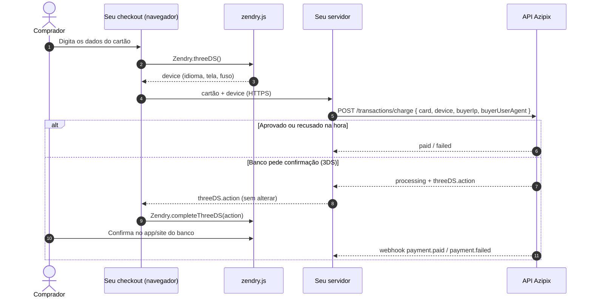

Escopo exigido: `charges:write`.

<Tip>
  **Não quer lidar com dados de cartão?** Use um [link de pagamento](/api-reference/payment-links/create): o checkout da Azipix coleta o cartão, faz o 3DS e confirma o pagamento por você.
</Tip>

## Como funciona

Os cartões são processados pela **Zendry**, sem tokenização: o cartão vai do seu checkout para o **seu servidor** e dele para a Azipix, por HTTPS. A Azipix usa o cartão só durante a autorização: **não armazena nem registra** número ou CVV e devolve apenas a bandeira e os 4 últimos dígitos. O 3DS (confirmação com o banco) roda no navegador do comprador com o script `zendry.js`, que não vê o cartão nem precisa de chave.

Antes de mostrar a opção de cartão no seu checkout, confira se ela está liberada: `routing.allowedPaymentMethods` precisa ter `credit_card`. Veja [Métodos e contas liberadas](/api-reference/account/routing).

<Warning>
  **PCI-DSS:** se o seu checkout recebe o número do cartão e o envia pelo seu servidor, os seus sistemas que tocam nesses dados entram no escopo do PCI-DSS (questionário SAQ D). Nunca grave número ou CVV, nem em logs. Se não quiser essa responsabilidade, use um [link de pagamento](/api-reference/payment-links/create).
</Warning>



### 1. Colete o cartão e os dados do navegador

```html
<script src="https://api.zendry.co/sdk/v1/zendry.js"></script>
<script>
  async function pagar(form) {
    // Dados do navegador para a análise 3DS (nenhum dado de cartão passa pelo SDK)
    const r = await Zendry.threeDS();
    const device = r.device ?? r;

    const resposta = await fetch("/seu-servidor/pagar", {
      method: "POST",
      headers: { "Content-Type": "application/json" },
      body: JSON.stringify({
        card: {
          number: form.numero.value.replace(/\D/g, ""),
          holderName: form.titular.value,
          expMonth: form.mes.value,  // "11"
          expYear: form.ano.value,   // "2028" ou "28"
          cvv: form.cvv.value,
        },
        device,
        installments: Number(form.parcelas.value),
      }),
    }).then((r) => r.json());

    // 3DS: o banco pediu confirmação ao comprador
    if (resposta.status === "processing" && resposta.threeDS?.action) {
      await Zendry.completeThreeDS(resposta.threeDS.action); // só para a tela
      // o resultado oficial vem pelo webhook ou por GET /transactions/{id}
    }
  }
</script>
```

### 2. Crie a cobrança no seu servidor

Envie o IP e o navegador **do comprador** (não os do seu servidor): eles alimentam a análise antifraude.

```javascript Node.js
app.post("/seu-servidor/pagar", async (req, res) => {
  const r = await fetch("https://api.azipix.com/api/transactions/charge", {
    method: "POST",
    headers: {
      "x-api-key": process.env.AZIPIX_KEY_ID,
      "x-api-secret": process.env.AZIPIX_SECRET_KEY,
      "Content-Type": "application/json",
      "X-Idempotency-Key": crypto.randomUUID(),
    },
    body: JSON.stringify({
      amountCents: 25000,
      paymentMethod: "credit_card",
      installments: req.body.installments,
      card: req.body.card,     // repasse sem gravar e sem logar
      device: req.body.device,
      buyerIp: req.ip,
      buyerUserAgent: req.get("user-agent"),
      description: "Pedido #4092",
      customer: { name: "Carlos Eduardo Lima", email: "carlos@exemplo.com", document: "52998224725" },
    }),
  });
  const charge = await r.json();
  // devolva ao front só o necessário: status, id, failureReason e threeDS
  res.status(r.status).json({ id: charge.id, status: charge.status, failureReason: charge.failureReason, threeDS: charge.threeDS });
});
```

<Note>
  O cartão exige o **CPF** do comprador (11 dígitos) em `customer.document`. O `threeDS.action` é de uso único e expira em 15 minutos: se o comprador não confirmar a tempo, a venda é recusada. Para tentar de novo, crie outra cobrança.
</Note>

## Corpo da requisição

<ParamField body="paymentMethod" type="string" required>`"credit_card"`</ParamField>

<ParamField body="amountCents" type="integer" required>
  Valor total em centavos (mínimo `100`). Em vez dele, você pode enviar `amount` em reais.
</ParamField>

<ParamField body="installments" type="integer" default="1">
  Número de parcelas, de 1 a 12. Parcelas acima de 1 podem ter tarifa adicional (veja suas taxas no painel).
</ParamField>

<ParamField body="customer" type="object" required>
  `name`, `email`, `document` (**CPF** do comprador, 11 dígitos) e `phone` (opcional).
</ParamField>

<ParamField body="card" type="object" required>
  Os dados do cartão. Nunca são armazenados nem registrados.
  <Expandable title="propriedades">
    <ParamField body="number" type="string" required>Número do cartão, 13 a 19 dígitos (espaços são ignorados).</ParamField>
    <ParamField body="holderName" type="string" required>Nome impresso no cartão.</ParamField>
    <ParamField body="expMonth" type="string" required>Mês de validade, `1` a `12`.</ParamField>
    <ParamField body="expYear" type="string" required>Ano de validade, `2028` ou `28`.</ParamField>
    <ParamField body="cvv" type="string" required>Código de segurança, 3 ou 4 dígitos.</ParamField>
  </Expandable>
</ParamField>

<ParamField body="device" type="object">
  O retorno de `Zendry.threeDS()`: `language`, `screen_height`, `screen_width`, `time_zone_offset`. Algumas contas com antifraude reforçado exigem.
</ParamField>

<ParamField body="buyerIp" type="string">IP do comprador (IPv4 ou IPv6).</ParamField>

<ParamField body="buyerUserAgent" type="string">User-agent do navegador do comprador (até 500 caracteres).</ParamField>

<ParamField body="description" type="string">Descrição do pedido (até 200 caracteres).</ParamField>

<ParamField body="utms" type="object">
  Opcional. Parâmetros de rastreamento (`utm_source`, `utm_medium`, `utm_campaign`, `utm_content`, `utm_term`, `src`, `sck`), enviados à sua conta [UTMify](/integrations/utmify) quando o pagamento é aprovado. Mesmas regras de [Criar Cobrança Pix](/api-reference/charges/create-pix).
</ParamField>

<ParamField body="subaccountId" type="string">Registra a venda numa [subconta](/api-reference/account/subaccounts) sua.</ParamField>

<ParamField header="X-Idempotency-Key" type="string">Valor único por tentativa. Veja [Idempotência](/idempotency).</ParamField>

## Respostas

<ResponseExample>
```json Aprovado
{
  "id": "tx_C0FFEE1234ABCD56",
  "status": "paid",
  "amountCents": 25000,
  "feeCents": 1871,
  "netCents": 23129,
  "paymentMethod": "credit_card",
  "installments": 3,
  "cardBrand": "mastercard",
  "cardLastFour": "4444",
  "createdAt": "2026-11-04T18:15:00.000Z",
  "paidAt": "2026-11-04T18:15:02.000Z"
}
```

```json Recusado
{
  "id": "tx_C0FFEE1234ABCD57",
  "status": "failed",
  "amountCents": 25000,
  "paymentMethod": "credit_card",
  "cardBrand": "visa",
  "cardLastFour": "1111",
  "failureReason": "Saldo ou limite insuficiente.",
  "createdAt": "2026-11-04T18:16:00.000Z"
}
```

```json 3DS pendente
{
  "id": "tx_C0FFEE1234ABCD58",
  "status": "processing",
  "amountCents": 25000,
  "paymentMethod": "credit_card",
  "cardBrand": "visa",
  "cardLastFour": "1111",
  "threeDS": {
    "provider": "zendry",
    "action": { "...": "repasse ao Zendry.completeThreeDS sem alterar" }
  },
  "createdAt": "2026-11-04T18:17:00.000Z"
}
```
</ResponseExample>

Uma recusa **não** é erro HTTP: a resposta é `201` com `status: "failed"` e o motivo em `failureReason`.

## Interpretando o resultado

| `status` | O que fazer |
| :--- | :--- |
| `paid` | Aprovado e confirmado na adquirente. Libere o pedido. |
| `processing` | Aguardando o banco: análise antifraude ou confirmação 3DS (`threeDS.action`). **Não cobre de novo.** A decisão chega por webhook (`payment.paid` ou `payment.failed`) e aparece em `GET /transactions/{id}`. |
| `failed` | Recusado. Mostre `failureReason` (ou uma mensagem genérica) e deixe tentar com outro cartão, numa cobrança nova. |
| `refunded` | Estornado. Você recebe `payment.refunded`. |

### Motivos de recusa

`failureReason` vem pronto para mostrar ao comprador. Exemplos:

- `Saldo ou limite insuficiente.`
- `Pagamento não autorizado pelo banco emissor. Tente outro cartão.`
- `Número do cartão inválido.`
- `Cartão vencido.`
- `Este cartão não pode ser usado para esta compra.`
- `Pagamento não autorizado por segurança. Fale com o banco emissor.`

## Estornos

Estornos são feitos pelo suporte Azipix. O estorno é **total** e só é possível em até **24 horas** após a aprovação. Você recebe o evento `payment.refunded` e o valor sai do seu saldo.

## Liquidação

O valor líquido (`netCents`) de vendas no cartão fica disponível para saque após o prazo de liquidação da sua conta (`settlementDays`, normalmente 30 dias). Até lá, aparece como **saldo a liberar**.
