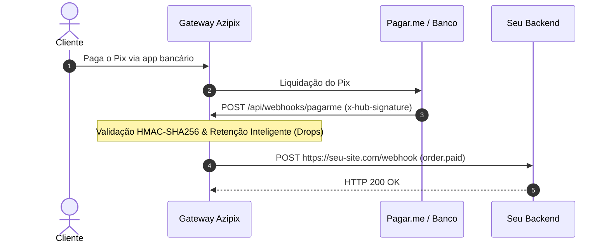

Os Webhooks permitem que a sua aplicação seja notificada de forma assíncrona e em tempo real sobre eventos financeiros (por exemplo, quando um Pix é pago pelo cliente ou um cartão é aprovado).

## URL do Webhook da Azipix no Pagar.me

Se você está conectando sua conta da **Pagar.me** (Stone Co. v5) à Azipix, configure a seguinte URL no painel da Pagar.me:

<Card title="URL de Postback / Webhook para o Pagar.me" icon="link" color="#9255F7">
  ```text
  https://api.azipix.com/api/webhooks/pagarme
  ```
</Card>

<Note>
  A Azipix também aceita a rota direta alternativa: `https://api.azipix.com/webhooks/pagarme`. Ambas processam com validação criptográfica HMAC-SHA256.
</Note>

### Como Configurar no Dashboard da Pagar.me

1. Acesse o **Dashboard da Pagar.me** ([dashboard.pagarme.com](https://dashboard.pagarme.com)).
2. Navegue até **Configurações** > **Webhooks**.
3. Clique em **Criar Webhook** (ou **Adicionar URL**).
4. Insira a URL: `https://api.azipix.com/api/webhooks/pagarme`.
5. Selecione a versão da API (**v5**).
6. Marque os eventos que deseja receber:
   - `order.paid`
   - `charge.paid`
   - `charge.payment_failed`
   - `charge.refunded`
7. Salve as configurações.

---

## Ciclo de Vida do Webhook



## Política de Retentativas

Caso seu servidor não responda com status `HTTP 200` em até 10 segundos, a Azipix efetuará retentativas automáticas seguindo um algoritmo de backoff exponencial:

- **1ª retentativa**: após 1 minuto
- **2ª retentativa**: após 5 minutos
- **3ª retentativa**: após 15 minutos
- **4ª retentativa**: após 1 hora
- **5ª retentativa**: após 6 horas
