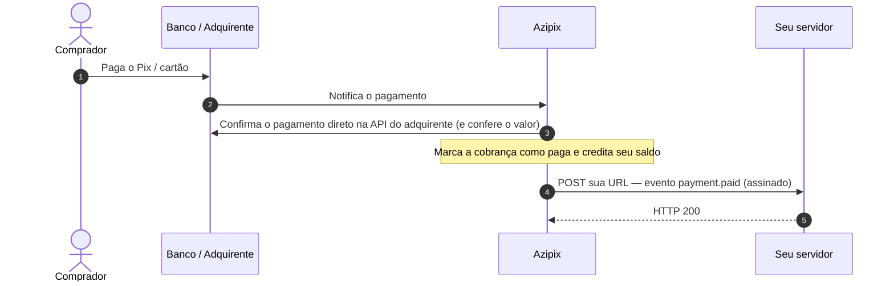

Um webhook é uma chamada `POST` que a Azipix faz para uma URL do **seu servidor** sempre que uma cobrança muda de status. É assim que você fica sabendo, sem precisar ficar consultando a API, que um Pix foi pago.

## Configuração

1. No painel, vá em **Integrações → Webhooks → Adicionar URL**.
2. Informe uma URL **https** do seu servidor (ex.: `https://sualoja.com/webhooks/azipix`). Você pode cadastrar até 5.
3. Copie o **Segredo** exibido na mesma tela. Ele serve para [validar a assinatura](/webhooks/signature) de cada chamada.

## Como funciona



A Azipix **só envia `payment.paid` depois de confirmar o pagamento na API do adquirente** e conferir que o valor pago é igual ao valor cobrado. Você pode liberar o pedido com segurança ao receber o evento, desde que a [assinatura seja válida](/webhooks/signature).

## O que a sua URL recebe

```http
POST /webhooks/azipix HTTP/1.1
Content-Type: application/json
User-Agent: Azipix-Webhooks/1.0
X-Azipix-Event: payment.paid
X-Azipix-Timestamp: 1793833200
X-Azipix-Signature: sha256=5d2c1f0a9e...
```

```json
{
  "event": "payment.paid",
  "data": {
    "id": "tx_8F3A1C9B2D7E4F60",
    "amount": 150,
    "amountCents": 15000,
    "feeCents": 179,
    "netCents": 14821,
    "paymentMethod": "pix",
    "status": "paid",
    "customer": {
      "name": "João da Silva",
      "email": "joao.silva@exemplo.com.br",
      "document": "52998224725"
    },
    "paidAt": "2026-11-04T18:01:12.000Z",
    "createdAt": "2026-11-04T18:00:00.000Z"
  }
}
```

Veja todos os eventos em [Eventos](/webhooks/events).

## Como responder

- Responda **HTTP 2xx em até 8 segundos**. Se o seu processamento for demorado, salve o evento numa fila, responda `200` na hora e processe depois.
- **Seja idempotente:** use `data.id` + `event` como chave. Se o mesmo evento chegar duas vezes, ignore o segundo.
- **Não confie só no webhook para cancelar pedidos.** Se uma notificação não chegar (seu servidor fora do ar, por exemplo), consulte `GET /transactions/{id}` antes de cancelar um pedido pendente.

<Warning>
  Hoje cada evento é enviado **uma vez**. Se a sua URL estiver fora do ar ou demorar mais de 8 segundos, a notificação se perde. Por isso, faça uma conciliação periódica: consulte pela API os pedidos que continuam pendentes.
</Warning>

## Testando localmente

Para receber webhooks no seu computador, exponha a porta local com um túnel (ngrok, Cloudflare Tunnel) e cadastre a URL `https://` gerada em **Integrações → Webhooks**. Depois, crie uma cobrança Pix de R$ 1,00 e pague.
